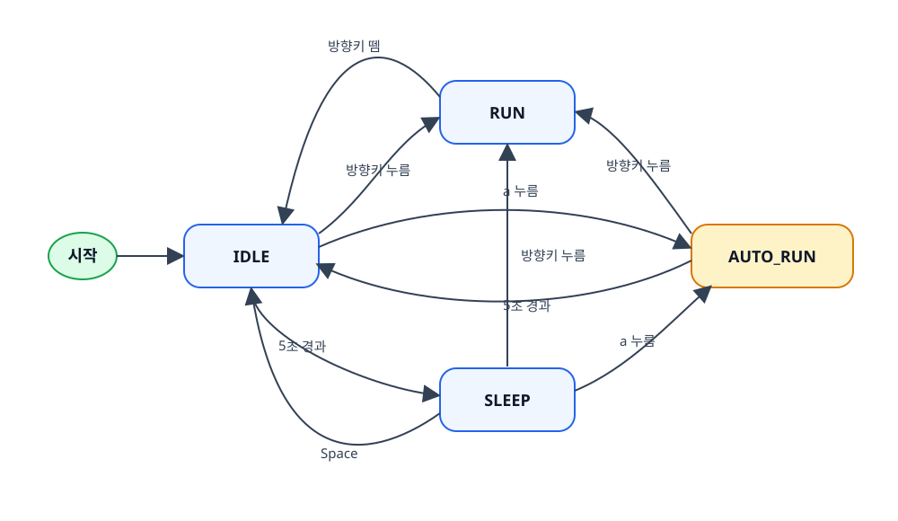

# Drill #11. 소년 - 자동 무적 런(AutoRun) 상태 추가 (5점)

- Idle 상태에서 'a'키를 누르면, 소년은 자동 무적 런 상태가 되어 키조작 없어도 계속 좌우로 이동하게 됨.
- 소년은 속도가 빨라지고, 크기가 확대되어야 함. 화면의 좌우측 끝에서 자동 방향 전환이 되어야 함.
- 자동 무적 런 상태에서 5초 이상 경과하면 IDLE 상태로 돌아감.
- 자동 무적 런 상태에서 방향키가 눌리면, 무적 런이 취소되고, 눌린 방향으로 움직이는 원래의 Run 상태로 돌아감.
- **중요: 반드시 AutoRun 상태 클래스를 추가해서 구현해야 함.**
- **중요: 제출물에 상태다이어그램을 그려서 함께 제출 – 저장소에 이미지 파일 포함 제출.**
- 채점 기준: 'a' 누르면 auto run 상태 이동(1점), 5초 이상 경과하면 Idle 상태 복귀(1점), auto run 모드에서 소년 속도가 빨라지고, 크기가 커짐(1점), auto run 모드에서 좌우측 끝에서 자동 방향 전환(1점), 상태 다이어그램(1점)
- AI 사용 개발. 과제 제출은 디스코드 공지된 실습 과제 제출 요령을 따라야 함.

## 상태 전환

- Idle 상태 → 'a' 누르면 → AutoRun 상태
- AutoRun 상태 → 5초 이상 경과하면 → Idle 상태
- AutoRun 상태 → 방향키 입력 → Run 상태

## 상태 다이어그램

AutoRun은 기본 달리기 속도의 2배로 이동하며, 스프라이트를 150×150 크기로 표시한다.
화면 경계는 확대된 스프라이트가 잘리지 않도록 좌우 각각 75픽셀 안쪽으로 적용한다.
IDLE 또는 SLEEP 상태에서 'a' 키를 눌러 AutoRun을 시작할 수 있다.

# 디스코드 공지된 실습 과제 제출 요령

- 개발 과정의 커밋 기록을 충분하고 적절하게 남겨야 합니다. 교수님께서 이를 지키지 않을 경우 0점 처리한다고 안내하셨습니다.
- 개발 기획·요구사항 문서 PRD.md를 반드시 포함해 주세요.
  실행에 필요한 코드와 이미지 파일을 함께 올리고, 업로드 여부를 확인해 주세요.

## 커밋 기록 꼭 반드시 충분하고 적절하게 남겨야 함 !! 매우 중요 !!
